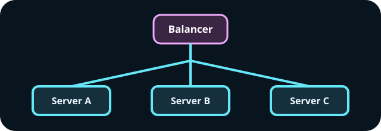

<div align="center">


<p><strong>A deterministic simulator for common load-balancing strategies.</strong></p>
   
<br/>
</div>

## 🧭 Overview
Load Balancer Lab simulates how synthetic requests are assigned to a small server pool. Compare round robin, weighted round robin, and least-connections using repeatable arrival and service-time values.

## ✨ Features
- 🔁 Compare three request-routing strategies.
- ⚖️ Configure server weights and simulated latency.
- 📊 View assignment counts as proportional bars.
- 🧾 Inspect individual synthetic request assignments.
- 🔒 Generate no real network traffic.

## 🎬 Demo
Start the app; a three-server configuration and a sample workload are ready. Switch strategies and run the same request count to compare distribution.

## 🚀 Quick Start
Requires Node.js 20 or newer.

```bash
npm start
```

Open http://127.0.0.1:4180. Run checks with npm test.

## 🧰 Tech Stack
- 🟢 Node.js built-in HTTP server
- 🌐 Browser JavaScript and CSS
- 🧪 Node.js built-in test runner

## 🗂️ Folder Structure
```text
public/       Routing simulator and interface
test/         Strategy and validation tests
assets/       Original SVG artwork
.github/      CI workflow
server.js     Dependency-free static server
```

## 🛣️ Roadmap
- [ ] Add random but seeded arrival patterns.
- [ ] Visualize server queue lengths over time.
- [ ] Compare failover behavior when a node is unavailable.

## 🤝 Contributing
Contributions are welcome. Keep simulations deterministic in tests and label synthetic time values clearly.

## 📄 License
MIT. See LICENSE.

<div align="center"></div>
